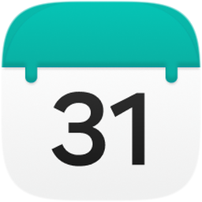
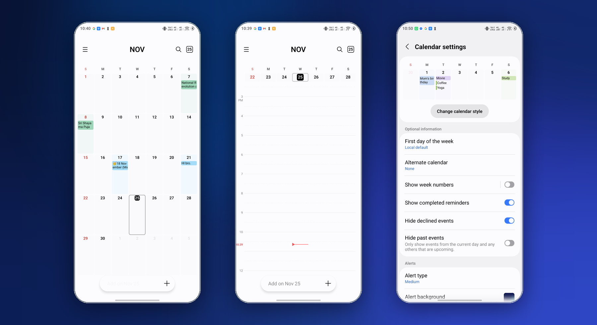
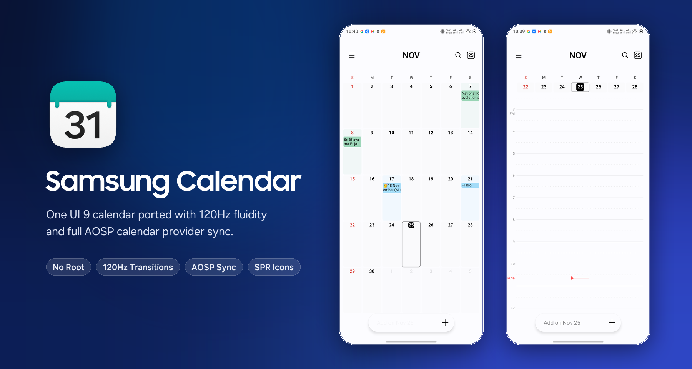

<h1>
  <picture>
    <source media="(prefers-color-scheme: dark)" srcset="assets/badges/title-dark.svg" />
    
  </picture>
</h1>

 

 

## Overview

**Samsung Calendar** is ported from **Samsung One UI 9** and optimized to run smoothly on **all non-Samsung Android devices** running **Android 12 through Android 16+** without requiring root access.

Samsung's stock Calendar crashes on non-Galaxy ROMs because it queries Galaxy-exclusive database columns inside the calendar content provider, relies on closed system framework classes, and renders proprietary bitmap sprite assets. This port adapts those calls to standard Android Calendar Provider APIs, locks 120Hz frame pacing across Month, Week, Day, Year, and Agenda switches, and decodes Samsung sprite assets cleanly.

 

---

## Highlights

<table>
<tr>
<td width="33%" valign="top">

### Native One UI 9 Views
- Clean Month, Week, Day, Year, and Agenda schedule layouts
- Full light and dark theme adaptation across all sheets
- High-resolution decoded event stickers and category icons

</td>
<td width="33%" valign="top">

### Cross-OEM Calendar Sync
- Seamless read/write sync with local and Google Calendar accounts
- Automatic translation of proprietary database column queries
- Safe empty fallback for unavailable Galaxy-only providers

</td>
<td width="33%" valign="top">

### 120Hz Motion Polish
- Locked high-refresh-rate window rendering on non-Samsung panels
- Hardware-layered snapshot cross-slides between view modes
- Decelerated One UI animation curves with zero first-frame stutter

</td>
</tr>
</table>

---

## Status Legend

| Badge | Meaning |
| :--- | :--- |
|  | Works reliably on standard non-root Android 12–16+ devices. |
|  | Restricted by third-party ROM background or provider policies without system privileges. |
|  | Depends on closed Samsung Galaxy companion apps or cloud services unavailable outside One UI. |

---

## How Every Feature Works

| Feature | Status | How It Works on Non-Samsung Android |
| :--- | :---: | :--- |
| **Month, Week, Day & Agenda Views** |  | Renders native One UI 9 calendar grids smoothly using standard Android view pipelines locked to your display's peak refresh rate. |
| **Google & Local Account Sync** |  | Translates Samsung provider projections dynamically onto your device's standard AOSP `CalendarContract` database and Google Calendar sync adapters. |
| **Event Creation, Recurrence & Alerts** |  | Creates, edits, and deletes single or repeating events with custom reminders stored directly inside standard Android calendar tables. |
| **Home Screen Widgets** |  | Renders Month, Countdown, and Agenda widgets natively on Pixel Launcher, OriginOS, HyperOS, ColorOS, and third-party launchers. |
| **Stickers & Category Icons** |  | Decodes bundled Samsung sprite containers into standard raster drawables so category icons appear accurately everywhere. |

---

## Compatibility and Limits

| Feature | Status | Why It Cannot Run Outside Galaxy Firmware |
| :--- | :---: | :--- |
| **Samsung Reminder App Sync** |  | Inline task checklists inside Calendar depend on Samsung's proprietary Reminder provider database unless the ported Reminder companion is installed alongside it. |
| **Galaxy Weather Forecast Strip** |  | Monthly forecast headers read Samsung's system Weather daemon content URI, which does not exist on non-Samsung OEM ROMs. |
| **Samsung Cloud Calendar Backup** |  | Direct Samsung Cloud sync requires Samsung Account system authenticators; use Google Calendar sync for multi-device backup. |

---

## Setup and Permissions

1. Download **`SamsungCalendar-OneUI9.apk`** from the [Latest Release](https://github.com/smartworldarafath/Samsung_Calender/releases/latest).
2. Install the APK on any non-Samsung Android 12–16+ phone (allow *Install unknown apps* if prompted).
3. Grant **Calendar** and **Notifications** permissions on first launch so events from Google and local accounts populate immediately.
4. On strict OEM ROMs (OriginOS, HyperOS, ColorOS), allow **Autostart / Background Activity** in App Info so upcoming event notifications fire reliably on time.
