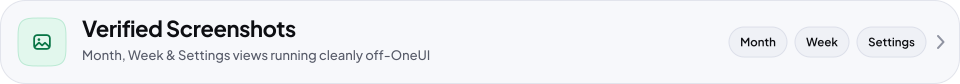
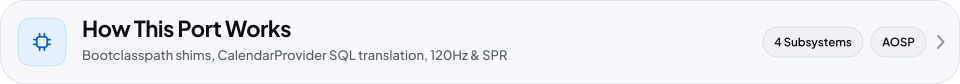
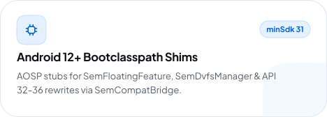
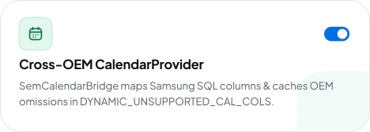
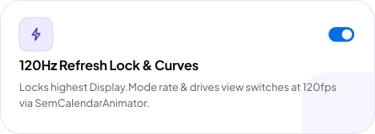
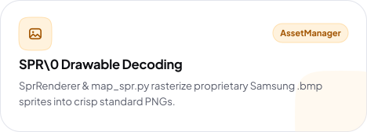
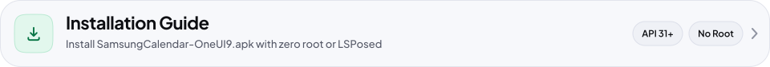
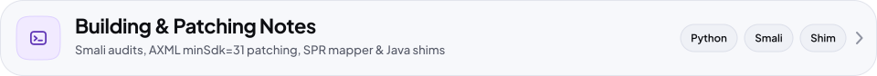
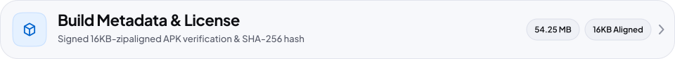

<div align="center" id="overview">
  
  <br/>
  <picture><source media="(prefers-color-scheme: dark)" srcset="assets/readme/dark/hero-title.svg"></picture>
</div>

<p align="center">
  <a href="../../releases/latest"><picture><source media="(prefers-color-scheme: dark)" srcset="assets/readme/dark/btn-download.svg"></picture></a>
  <a href="#how-this-port-works"><picture><source media="(prefers-color-scheme: dark)" srcset="assets/readme/dark/btn-architecture.svg"></picture></a>
  <a href="#screenshots"><picture><source media="(prefers-color-scheme: dark)" srcset="assets/readme/dark/btn-screenshots.svg"></picture></a>
  <a href="#building--patching-notes"><picture><source media="(prefers-color-scheme: dark)" srcset="assets/readme/dark/btn-patching.svg"></picture></a>
</p>

<p align="center">
  <picture><source media="(prefers-color-scheme: dark)" srcset="assets/readme/dark/badge-oneui.svg"></picture>
  <a href="../../releases/latest"><picture><source media="(prefers-color-scheme: dark)" srcset="assets/readme/dark/badge-version.svg"></picture></a>
  <picture><source media="(prefers-color-scheme: dark)" srcset="assets/readme/dark/badge-sdk.svg"></picture>
  <picture><source media="(prefers-color-scheme: dark)" srcset="assets/readme/dark/badge-noroot.svg"></picture>
  <a href="#how-this-port-works"><picture><source media="(prefers-color-scheme: dark)" srcset="assets/readme/dark/badge-calbridge.svg"></picture></a>
  <a href="#how-this-port-works"><picture><source media="(prefers-color-scheme: dark)" srcset="assets/readme/dark/badge-120hz.svg"></picture></a>
  <a href="#how-this-port-works"><picture><source media="(prefers-color-scheme: dark)" srcset="assets/readme/dark/badge-spr.svg"></picture></a>
</p>

<p align="center">
  <a href="#overview"><picture><source media="(prefers-color-scheme: dark)" srcset="assets/readme/dark/tab-overview.svg"></picture></a>
  <a href="#screenshots"><picture><source media="(prefers-color-scheme: dark)" srcset="assets/readme/dark/tab-screenshots.svg"></picture></a>
  <a href="#how-this-port-works"><picture><source media="(prefers-color-scheme: dark)" srcset="assets/readme/dark/tab-architecture.svg"></picture></a>
  <a href="#installation"><picture><source media="(prefers-color-scheme: dark)" srcset="assets/readme/dark/tab-install.svg"></picture></a>
  <a href="#what-works--known-limitations"><picture><source media="(prefers-color-scheme: dark)" srcset="assets/readme/dark/tab-compat.svg"></picture></a>
  <a href="#building--patching-notes"><picture><source media="(prefers-color-scheme: dark)" srcset="assets/readme/dark/tab-build.svg"></picture></a>
  <a href="#build-metadata"><picture><source media="(prefers-color-scheme: dark)" srcset="assets/readme/dark/tab-metadata.svg"></picture></a>
</p>

---

Stock One UI system apps aren't built to run outside Samsung's firmware. If you extract Calendar straight off a Galaxy running One UI 9 and sideload it onto a Pixel, vivo, Xiaomi, OnePlus, or an AOSP custom ROM, Android rejects the APK before installation even starts (`minSdk 35/36` / target framework mismatch) — and even if forced to install, it crashes immediately on `SemFloatingFeature`, `SemDvfsManager`, missing Android 13–16 APIs, and Samsung-only columns inside `com.android.calendar`.

This project takes **Samsung Calendar `12.7.06.13`** from One UI 9 and makes it a self-contained, daily-usable APK for **any Android 12+ device** — keeping Samsung's Month/Week/Agenda UI, gesture feel, and icons intact while translating everything under the hood to standard AOSP.

<h2 id="screenshots"><picture><source media="(prefers-color-scheme: dark) and (max-width: 640px)" srcset="assets/readme/dark/hm-screenshots.svg"><source media="(prefers-color-scheme: dark)" srcset="assets/readme/dark/h-screenshots.svg"><source media="(max-width: 640px)" srcset="assets/readme/light/hm-screenshots.svg"></picture></h2>

<p align="center">
  
  
  
</p>

---

<h2 id="how-this-port-works"><picture><source media="(prefers-color-scheme: dark) and (max-width: 640px)" srcset="assets/readme/dark/hm-architecture.svg"><source media="(prefers-color-scheme: dark)" srcset="assets/readme/dark/h-architecture.svg"><source media="(max-width: 640px)" srcset="assets/readme/light/hm-architecture.svg"></picture></h2>

<table width="100%">
  <tr>
    <td width="50%" align="center" valign="top">
      <picture><source media="(prefers-color-scheme: dark)" srcset="assets/readme/dark/card-shims.svg"></picture>
    </td>
    <td width="50%" align="center" valign="top">
      <picture><source media="(prefers-color-scheme: dark)" srcset="assets/readme/dark/card-calbridge.svg"></picture>
    </td>
  </tr>
  <tr>
    <td width="50%" align="center" valign="top">
      <picture><source media="(prefers-color-scheme: dark)" srcset="assets/readme/dark/card-animator.svg"></picture>
    </td>
    <td width="50%" align="center" valign="top">
      <picture><source media="(prefers-color-scheme: dark)" srcset="assets/readme/dark/card-spr.svg"></picture>
    </td>
  </tr>
</table>

### 1. Android 12+ Backport (`minSdk 31`) & Samsung Bootclasspath Shims
One UI 9 compiles against Android 15/16 (`API 35/36`) plus Samsung's private framework JARs (`sem.*`). Running that bytecode unmodified on Android 12 or non-Samsung ROMs triggers `NoClassDefFoundError` and `NoSuchMethodError` across the app lifecycle.

- **Bootclasspath stubs (`shim/src/`, `shim/outer_src/`)**: Implements safe AOSP fallbacks for `FloatingFeature`, `SemFloatingFeature`, `SemCscFeature`, `SemWindowManager`, `SemDvfsManager`, `SemPersonaManager`, `SemSystemProperties`, `SemStatusBarManager`, `SemBlurInfo`, `ICoverManager`, and extended `Activity` / `ActivityManager` / `VibrationEffect` signatures.
- **API 32–36 rewrite layer (`SemCompatBridge` & `SemAospBridge`)**: Scans decompiled smali via `scripts/audit_android12_compat.py` against `android-36`'s `api-versions.xml` and rewrites newer platform calls (`registerReceiver` export flags, `PendingIntent` background activity launch flags, `ComponentCaller`, `LocaleManager`, vibrator helpers, display metrics) into runtime-checked shims.
- **Binary manifest patching (`scripts/patch_and_merge.py`)**: Updates `minSdkVersion` (`0x0101020c`) directly inside the compiled binary `AndroidManifest.xml` (`AXML`) to `31` and injects the compiled shim DEX cleanly without corrupting resource tables.

### 2. Cross-OEM `CalendarProvider` Translation (`SemCalendarBridge`)
On a Galaxy phone, Samsung's CalendarProvider (`com.android.calendar`) includes proprietary columns that simply do not exist on AOSP, Google Pixel, OriginOS, HyperOS, or ColorOS. Unmodified queries crash with `SQLiteException: no such column` or `IllegalArgumentException: Invalid column`.

`SemCalendarBridge` wraps `ContentResolver` queries, inserts, updates, deletes, and `ContentProviderOperation` batches (`applyBatch`) at runtime:
- Maps Samsung column names (such as `calendar_selected`, `sec_visible`, `secOriginalSyncId`, and extra event/attendee/reminder fields) onto standard AOSP `CalendarContract` columns.
- Parses SQLite/ContentProvider errors dynamically if an OEM ROM drops an extra column, caches it in `DYNAMIC_UNSUPPORTED_CAL_COLS`, and retries the query cleanly without crashing.
- Wraps returned cursors in `SamsungProjectionCursorWrapper` so Samsung's UI code still sees the exact column layout it expects while the underlying data comes straight from your device's AOSP/Google CalendarProvider.
- Short-circuits queries to nonexistent Samsung companion authorities (`com.samsung.android.app.reminder`, `smartsuggestions`, `rubin`, `holidays`, `scloud`, `scpm`, `stickercenter`, etc.) cleanly with empty cursors instead of dead IPC timeouts.

### 3. 120Hz Refresh Rate Lock & Transition Polish (`SemCalendarAnimator`)
On several non-Samsung phones, stock ported One UI apps stay throttled at 60Hz or drop frames when swapping between Month, Week, Year, and Agenda views.

- Hooks `Application.ActivityLifecycleCallbacks` (`CalendarApplication` -> `SemCalendarAnimator.install`) across `MainActivity`, `AgendaActivity`, `ManageCalendarActivity`, `EditSharedCalendarActivity`, Settings, and event Detail screens.
- Queries supported `Display.Mode` entries and locks the highest refresh rate on both the `Window` (`preferredDisplayModeId`) and view tree surfaces (`Surface.setFrameRate`).
- Renders hardware-cached snapshots (`ImageView` overlay) of the outgoing view during container switches and drives incoming/outgoing layers with a `230ms` decelerate curve (`PathInterpolator(0.22f, 1.0f, 0.36f, 1.0f)`), keeping view switching fluid at 120fps.

### 4. Samsung `SPR\0` Drawable Decoding (`SprRenderer`)
Some bundled `.bmp` resources in One UI apps aren't standard Windows bitmaps — they use Samsung's proprietary `SPR\0` vector/compressed sprite container, which AOSP SKIA refuses to decode. `SprRenderer.java` and `scripts/map_spr.py` use Android's `AssetManager` resource loader to rasterize those entries out into standard PNGs so icons and indicators show up properly everywhere.

---

<h2 id="installation"><picture><source media="(prefers-color-scheme: dark) and (max-width: 640px)" srcset="assets/readme/dark/hm-install.svg"><source media="(prefers-color-scheme: dark)" srcset="assets/readme/dark/h-install.svg"><source media="(max-width: 640px)" srcset="assets/readme/light/hm-install.svg"></picture></h2>

1. Grab **`SamsungCalendar-OneUI9.apk`** from [**Releases**](../../releases/latest) (or directly from [`apk/SamsungCalendar-OneUI9.apk`](apk/SamsungCalendar-OneUI9.apk)).
2. Enable **Install unknown apps** for your browser or file manager if Android asks.
3. Install normally — **no root, LSPosed, or Magisk module needed**.
4. Open the app and allow **Calendar** and **Notifications** permissions. Your existing Google / Exchange / local calendars synced on the phone will populate automatically through Android's CalendarProvider.

> [!NOTE]
> **Already on a Samsung One UI ROM?** Because this APK is re-signed so it can install and run outside Samsung's platform key, it won't overwrite a pre-installed system `com.samsung.android.calendar` with an intact system signature unless you remove/disable the stock package first or test on a secondary profile.

---

<h2 id="what-works--known-limitations"><picture><source media="(prefers-color-scheme: dark) and (max-width: 640px)" srcset="assets/readme/dark/hm-compat.svg"><source media="(prefers-color-scheme: dark)" srcset="assets/readme/dark/h-compat.svg"><source media="(max-width: 640px)" srcset="assets/readme/light/hm-compat.svg"></picture></h2>

- **Works out of the box**: Month / Week / Day / Year / Agenda views, event creation & editing, recurring rules, reminders & notifications, Google/Exchange sync (via Android's system sync adapters), calendar visibility toggles, dark/light theme, and 120Hz scrolling/transitions.
- **Not functional off-OneUI**: Samsung-cloud-only features that depend on Samsung Account, Bixby Routines, Samsung Reminder app sync, or Sticker Center will gracefully stay inactive when those system services aren't installed on the device.

---

<h2 id="building--patching-notes"><picture><source media="(prefers-color-scheme: dark) and (max-width: 640px)" srcset="assets/readme/dark/hm-build.svg"><source media="(prefers-color-scheme: dark)" srcset="assets/readme/dark/h-build.svg"><source media="(max-width: 640px)" srcset="assets/readme/light/hm-build.svg"></picture></h2>

Everything needed to inspect or reproduce the compatibility patches is checked into this repo:

```text
├── apk/SamsungCalendar-OneUI9.apk   # Signed, 16KB-zipaligned build (v12.7.06.13)
├── assets/                          # Squircle icon & clean device screenshots
├── modified_smali/                  # Hand-patched Calendar smali classes
├── scripts/
│   ├── audit_android12_compat.py    # Finds API 32–36 symbols missing on API 31
│   ├── patch_android12_compat.py    # Rewrites smali framework & Calendar calls to shims
│   ├── patch_and_merge.py           # Sets binary AXML minSdk=31 & merges shim DEX
│   └── map_spr.py                   # Locates Samsung SPR\0 drawable entries
└── shim/
    ├── SprRenderer.java             # Offline SPR -> PNG asset rasterizer
    ├── src/ & outer_src/            # Samsung & Android framework stubs
    └── src_bridge/com/samsung/shim/ # SemCompatBridge, SemAospBridge, SemCalendarBridge, SemCalendarAnimator
```

If you run the Python tooling against your own decompiled tree, set `SAMSUNG_PORT_BASE` to your working directory (or run from a copy of the repo root with `clock_smali/` / `cal_smali/` present) before running `audit_android12_compat.py` and `patch_android12_compat.py`.

---

<h2 id="build-metadata"><picture><source media="(prefers-color-scheme: dark) and (max-width: 640px)" srcset="assets/readme/dark/hm-metadata.svg"><source media="(prefers-color-scheme: dark)" srcset="assets/readme/dark/h-metadata.svg"><source media="(max-width: 640px)" srcset="assets/readme/light/hm-metadata.svg"></picture></h2>

| Field | Value |
| :--- | :--- |
| **Package** | `com.samsung.android.calendar` |
| **Version** | `12.7.06.13` (`1270613000`) |
| **SDK Range** | `minSdk 31` (Android 12) · `targetSdk 36` (Android 16) |
| **APK Size** | `54.25 MB` (`56,886,003` bytes) |
| **SHA-256** | `396AB8DB78C5BDBB2E0968C98A13709ACF07A10AC881D5868B062F49143F87F1` |

### License

Refer to [LICENSE](LICENSE). All original Samsung One UI assets and binaries remain the intellectual property of Samsung Electronics Co., Ltd.
