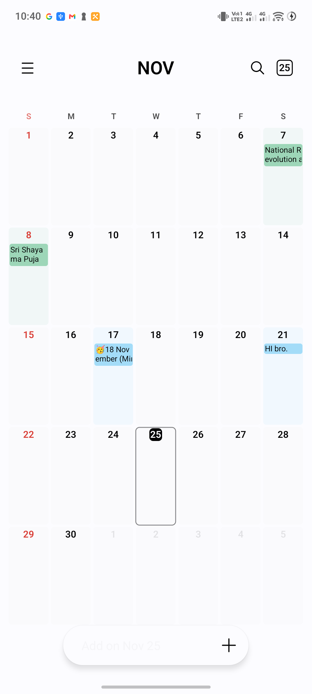
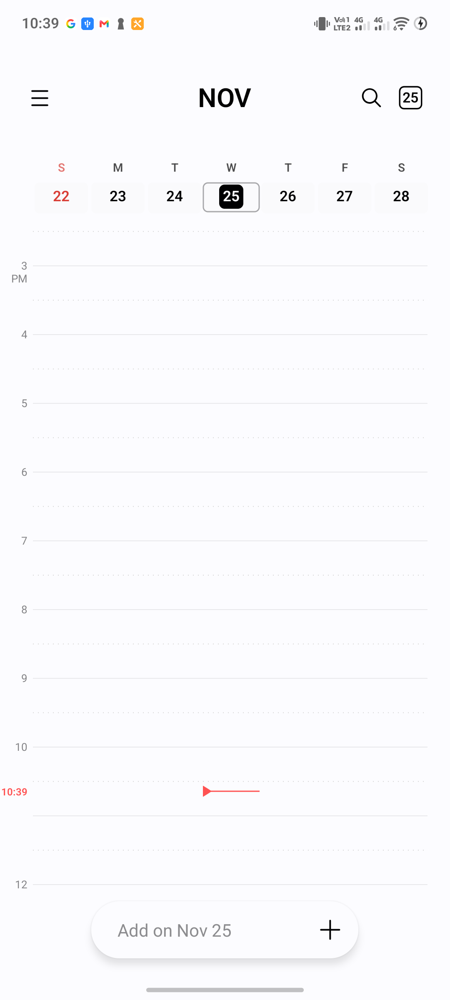
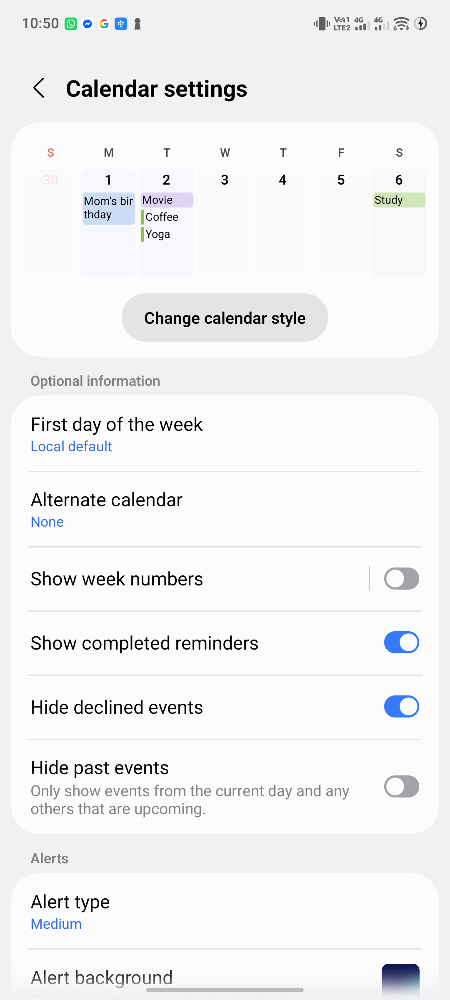

<div align="center">


# Samsung Calendar (One UI 9 Port)

**Ported from a Samsung One UI 9 device to run smoothly on any Android 12+ (`API 31+`) smartphone.**

-3DDC84?style=flat-square&logo=android&logoColor=white)
-1428A0?style=flat-square)


</div>

---

## Overview

This repository contains the **Samsung Calendar (`com.samsung.android.calendar` v12.7.06.13)** port extracted from One UI 9 and adapted via a custom AOSP/One UI compatibility shim (`SemCompatBridge`, `SemCalendarBridge`, `SemCalendarAnimator`, and Samsung `.spr` bitmap decoding support) so it installs and runs reliably on **non-Samsung Android 12–16 devices** (vivo OriginOS, Xiaomi HyperOS, Oppo ColorOS, OnePlus OxygenOS, Google Pixel, Nothing OS, LineageOS/AOSP, and more) as well as Samsung phones.

## Key Features & Fixes

- **Universal Android 12+ (`minSdk 31`) Support**:
  - Backported Android 13/14/15/16 platform APIs (`registerReceiver` export flags, `ComponentCaller`, `PendingIntent` background activity launch creators, locale/vibrator helpers) through `SemCompatBridge`.
  - Replaced missing Samsung Framework (`sem.*` / `FloatingFeature` / `SemCscFeature` / `SemPersonaManager` / `SemDvfsManager`) calls with safe AOSP shims (`shim/src/` and `shim/outer_src/`).
- **Cross-OEM CalendarProvider Schema Compatibility (`SemCalendarBridge`)**:
  - Rewrites Samsung-specific `CalendarContract` columns (such as `calendar_selected`, `sec_visible`, `secOriginalSyncId`, and non-AOSP event/calendar/attendee/reminder projection fields) to standard AOSP `CalendarContract` columns so event creation, month/week views, manage calendars, and shared calendars work cleanly on any OEM's CalendarProvider without `SQLiteException`.
- **True 120Hz High-Refresh-Rate & GPU-Accelerated Animations (`SemCalendarAnimator`)**:
  - Hooks every resumed Activity (`MainActivity`, `AgendaActivity`, `DetailActivity`, `SettingsActivity`, etc.) to request the highest available display refresh rate (`120Hz`) on `Window` and `Surface` (via `WindowManager.LayoutParams.preferredDisplayModeId` & `Surface.setFrameRate`).
  - Installs hardware-layer transitions and smooth global motion polish across Month/Week/Year/Day views and activity navigation.
- **Decoded Samsung `.bmp` (`SPR`) Graphics**:
  - Includes `SprRenderer.java` and `map_spr.py` tooling for handling Samsung's proprietary `SPR\0` compressed drawable assets on standard Android renderers.

## Screenshots

<p align="center">
  
  
  
</p>

## Installation

1. Download **`SamsungCalendar-OneUI9.apk`** from the [GitHub Releases](../../releases) page (or from [`apk/SamsungCalendar-OneUI9.apk`](apk/SamsungCalendar-OneUI9.apk)).
2. Enable **Install unknown apps** if prompted by Android.
3. Install the APK directly — **no root or Magisk required** (compatible with Android 12 / API 31 and above).
4. Grant Calendar & Notification permissions on first launch so your local and synced Google/Exchange calendars appear immediately.

> [!NOTE]
> Because this port is re-signed to install cleanly alongside non-Samsung system apps, if you already have stock Samsung Calendar installed as a system app on a Samsung ROM with a different signature, use ADB (`adb install -r`) only when upgrading previous builds signed with the same key.

## Repository Structure

```text
├── apk/                        # Ready-to-install patched Android 12+ APK
├── assets/                     # App icon and screenshots
├── modified_smali/             # Key patched smali entrypoints for Samsung Calendar
├── scripts/                    # Android 12 compat auditor, smali patcher & AXML merger
└── shim/                       # Java compatibility layer (SemCompatBridge, SemCalendarBridge, SemCalendarAnimator, SprRenderer)
```

## Build & Patch Tooling

- [`scripts/audit_android12_compat.py`](scripts/audit_android12_compat.py) — Scans decompiled smali for API 32–36 calls unsupported on Android 12.
- [`scripts/patch_android12_compat.py`](scripts/patch_android12_compat.py) — Rewrites One UI / Android 13+ framework calls to `SemCompatBridge` / `SemAospBridge` / `SemCalendarBridge`.
- [`scripts/patch_and_merge.py`](scripts/patch_and_merge.py) — Updates binary `AndroidManifest.xml` `minSdkVersion` (`0x0101020c`) to `31` and merges the compiled shim DEX.

## Verification & Checksum

| Property | Value |
| :--- | :--- |
| **Package Name** | `com.samsung.android.calendar` |
| **Version** | `12.7.06.13` (`1270613000`) |
| **Min SDK / Target SDK** | `31` (Android 12) / `36` (Android 16) |
| **APK Size** | `~54.25 MB` |
| **SHA-256** | `396AB8DB78C5BDBB2E0968C98A13709ACF07A10AC881D5868B062F49143F87F1` |

## License

See [LICENSE](LICENSE).
